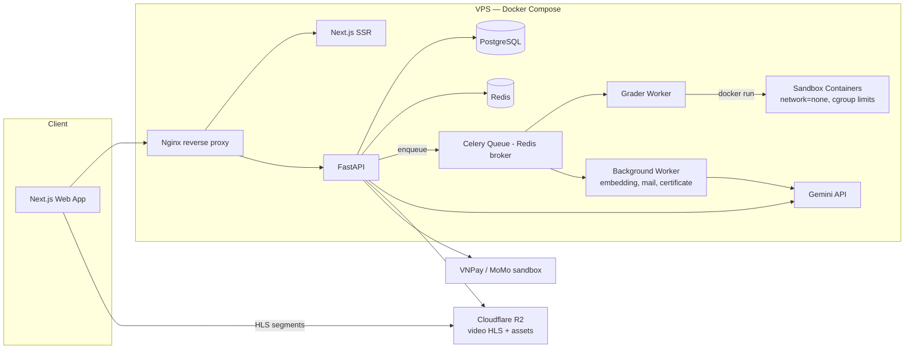

# Kiến trúc hệ thống

## Sơ đồ tổng thể



## Các thành phần

| Thành phần | Vai trò | Ghi chú |
|---|---|---|
| Next.js | UI, SSR trang public (SEO), client app cho trải nghiệm học | Không có business logic |
| FastAPI | REST API duy nhất, auth JWT, authorization | Layering: router → service → model |
| PostgreSQL | Nguồn chân lý dữ liệu | Full-text search bằng `tsvector` (đủ cho phạm vi khóa luận, khỏi cần Elasticsearch) |
| Redis | Cache, session/refresh token, leaderboard (sorted set), rate limit, Celery broker, pub/sub tiến độ chấm bài | |
| Celery workers | Job async: chấm bài, sinh embedding, sinh chứng chỉ PDF, gửi mail | Queue riêng cho grading (ưu tiên) và background |
| Grader | Nhận job, điều phối Docker sandbox, tổng hợp verdict | Chi tiết bảo mật: skill `sandbox-grading` |
| Cloudflare R2 | Video HLS, thumbnail, tài liệu | Egress miễn phí; upload qua presigned URL |
| Gemini API | Chatbot RAG, sinh quiz | Free tier; luôn có fallback khi API lỗi/quota |

## Ba luồng kỹ thuật trọng điểm

### 1. Chấm mã nguồn (⭐ điểm nhấn 1)

```
Submit code → API validate + tạo submission(pending) → Celery queue "grading"
→ Grader worker → docker run (image theo ngôn ngữ, cô lập hoàn toàn)
→ chạy từng test case → verdict per test → update DB
→ Redis pub/sub → client nhận realtime (WebSocket, fallback polling)

Lỗi phía hệ thống (SE) được thử lại 3 lần rồi "đỗ" hàng nộp bài lại ở trạng thái
`error` kèm lý do — không bao giờ ghi thành verdict. Sai, chậm, tràn bộ nhớ là
câu trả lời về bài nộp nên không thử lại.
```

**Pub/sub là lời kể, cơ sở dữ liệu là nguồn chân lý.** Redis pub/sub không có bộ
nhớ: phát cho ai đang nghe tại đúng khoảnh khắc đó, không hàng đợi, không phát
lại, không xác nhận. Nên WebSocket `/submissions/{id}/events` **mở đầu bằng một
snapshot đọc từ Postgres** và cứ 10 giây im lặng lại đọc thêm một cái. Một cơ
chế trả lời cả bốn hỏng hóc: client vào muộn, thông điệp mất lúc subscription
chưa sẵn sàng, kết nối Redis đứt, worker chết để lại dòng `running`.

Vì vậy "fallback polling" tồn tại ở hai tầng, không phải một: Redis chết thì
socket tự hạ cấp thành vòng đọc CSDL; WebSocket không mở được thì client chuyển
sang `GET /submissions/{id}`. Cả hai đường phát ra cùng một kiểu dữ liệu, và
kiểu ấy không có trường nào chứa output hay input — nên luật "test case ẩn
không rời máy chủ" không cần thêm bộ lọc nào trên đường realtime.

### 2. Chatbot RAG (⭐ điểm nhấn 3)

```
Ingest (async khi giảng viên upload): transcript/tài liệu → chunk (~500 token, overlap)
→ Gemini embedding → lưu pgvector
Query: câu hỏi học viên → embed → similarity search top-k (lọc theo course_id)
→ prompt Gemini kèm context + system prompt trợ giảng → trả lời có trích nguồn bài học
```

- Dùng **pgvector** ngay trong PostgreSQL — không thêm vector DB riêng.
- Chat history lưu DB, giới hạn context window theo phiên.

### 3. Hybrid Recommender (⭐ điểm nhấn 2)

- **Content-based:** embedding (title + description + category) → cosine similarity, giải quyết cold-start item.
- **Collaborative filtering:** implicit feedback (enroll=1, hoàn thành=2, rating ≥4=3, lấy mức mạnh nhất; rating ≤2 kéo về 1) → **item-based CF** (cosine giữa các khóa học) — `backend/app/services/collaborative.py`. Đã cân nhắc ALS (thư viện `implicit`) và không chọn: với vài chục user, vector ẩn của ALS chủ yếu là nhiễu phụ thuộc seed, không kiểm tay được và không giải thích được vì sao gợi ý; item-based thì tất định và mỗi gợi ý kèm khóa học đã "sinh" ra nó.
- **Hybrid:** weighted blend, fallback content-based + phổ biến-theo-danh-mục khi user mới.
- Tính offline theo batch (Celery beat, mỗi đêm), cache kết quả top-N per user vào Redis.
- Đánh giá: precision@k, recall@k trên tập held-out từ dữ liệu seed — script tại `backend/scripts/eval_recommender.py`.

## Quyết định kiến trúc đã chốt

| Quyết định | Lý do |
|---|---|
| Monolith FastAPI + workers (không microservices) | Một người làm trong 14 tuần; tách process theo vai trò (API/worker) là đủ "hệ phân tán" để trình bày |
| pgvector thay vì vector DB riêng | Ít moving part, đủ quy mô demo |
| Postgres FTS thay vì Elasticsearch | Như trên |
| WebSocket cho kết quả chấm, fallback polling | Realtime là điểm demo ăn tiền |
| Python-only grading ở v1 | Image per-language thiết kế sẵn chỗ mở rộng |
| Worker chấm bài giữ socket Docker, và là container duy nhất được giữ | Chấm bài *là* việc khởi động container, nên tiến trình chấm phải nói chuyện được với daemon. Socket không phải hệ thống phân quyền: container nào cầm nó cũng khởi động được container tùy ý trên host. Đổi lại, nó không phục vụ HTTP, không mở ra ngoài, và không tự chạy dòng code nào của người nộp — mọi dòng đó chạy trong container dùng một lần mà nó tạo ra |
